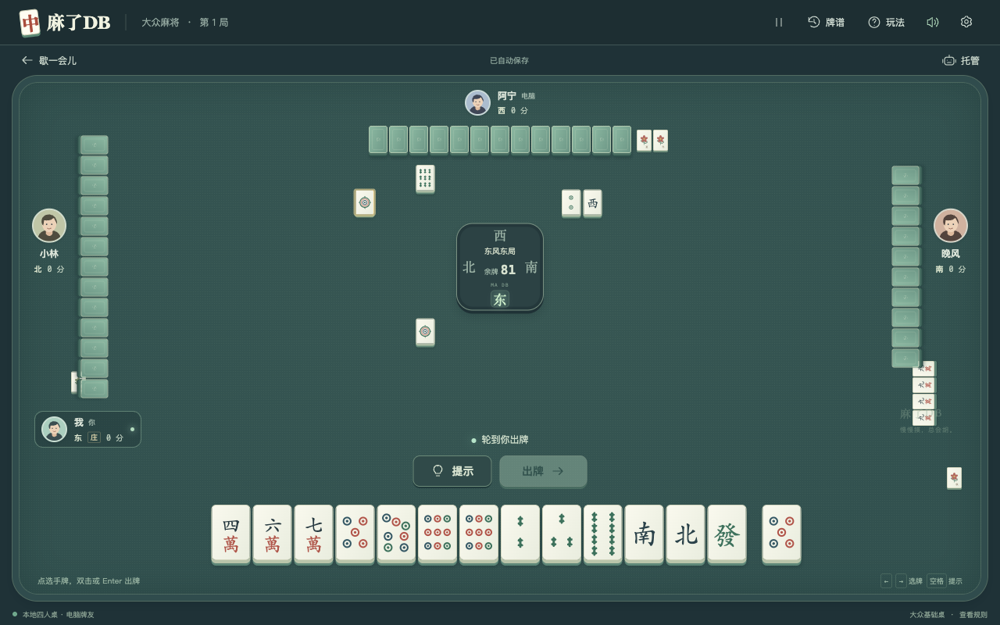
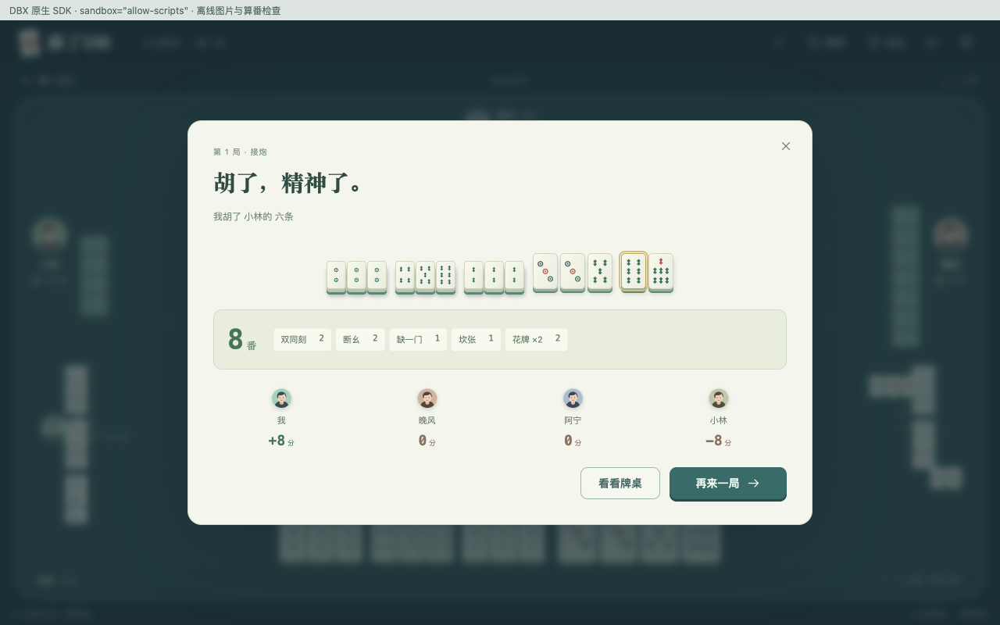

# 麻了DB

**写麻了？摸两张。**

DBX 的独立四人大众麻将插件。红中打工人首页、青瓷牌桌、普通昵称的电脑牌友；DBX 的元素保留在牌背和工作台细节里，行牌使用正常麻将规则。

[候选安装包](https://github.com/yuwenGueen/dbx-maledb/releases) · [问题反馈](https://github.com/yuwenGueen/dbx-maledb/issues) · [数据与原生进程说明](docs/security.md)

## 本地安装

当前开发包：`dist/dev.maledb.mahjong-0.1.0-darwin-arm64.dbxp`，适用于 **macOS Apple Silicon** 和 DBX **0.6.36+**。

在 DBX 插件中心的设置中启用「允许安装未签名开发包」，使用「从本地安装」选择 `.dbxp`，再打开「麻了DB」工作台。当前版本是未签名商店候选；正式商店包由 DBX Store 审核后签名，候选发布本身不代表已经上架。

## 已实现

- 一位玩家和三位电脑牌友，正常昵称与头像。
- 144 张牌，自动补花，庄家与圈风轮转。
- 吃、碰、明杠、暗杠、补杠、抢杠胡、接炮与自摸；按响应优先级处理。
- 原生算番核心，结算展示实际命中的番型、互斥结果和分值。
- 点击选牌，双击或 Enter 出牌，方向键选牌，空格提示，Esc 暂停。
- 摸牌、落牌、吃碰杠胡的动效与本地合成音效；音效可关闭，尊重系统减少动态效果设置。
- 托管、随时暂停、返回首页后续局、昵称与速度设置、本地自动保存与最近 30 局牌谱。
- 所有图片、脚本和样式离线随包提供。插件不需要数据库、网络、AI、文件或剪贴板读取权限。

## 采用的规则

参考欢乐麻将的大众玩法，采用以下**固定基础桌**。不同平台版本和房间选项可能不同；这里明确列出插件实际实现的规则，不声称逐项复刻腾讯所有场次。

| 项目 | 本桌约定 |
| --- | --- |
| 牌组 | 万筒条、风箭牌，每种 4 张，加 8 张花牌，共 144 张 |
| 起手 | 庄家 14 张，其他各 13 张；花牌自动补齐 |
| 胡牌门槛 | 成牌即可胡，无 8 番门槛 |
| 基本和型 | 四组面子和一对将牌；同时识别七对、十三幺、全不靠、组合龙等 |
| 吃牌 | 只吃上家；碰与明杠可以响应任意其他座位 |
| 响应 | 胡优先于杠、碰、吃；同时可胡时按离放炮者最近的座位截胡 |
| 杠 | 明杠、暗杠、补杠；补杠支持抢胡；补牌从牌尾摸取 |
| 计番 | 使用 GB-Mahjong 国标番型核心及互斥规则，花牌每张 1 番 |
| 胡牌分 | 底分、房间倍率均为 1；自摸三家各付一份番数，接炮由放炮者付一份 |
| 其他倍率 | 不带财神、扎鸟、打漂、额外杠分或庄家翻倍；不采用国标比赛的 8 分底分 |
| 下一局 | 庄家胡或流局时连庄，其他玩家胡牌时庄家顺序轮转 |

这是本地单机桌。当前不包含局域网或在线多人对战。电脑决策只使用自身手牌与公开信息，不读取其他玩家手牌；提示采用基础牌效策略，不能保证最优。

## 开发

需要 Node.js 22.12+、Go 1.22+ 与 Xcode Command Line Tools（Clang/C++）。原生规则源码与 DBX Go SDK 已随项目保存。

```sh
npm install --ignore-scripts
npm run dev
```

预览地址为 `http://127.0.0.1:5217`，仅监听本机。可用 `MALEDB_PORT` 改端口。

```sh
npm run build    # 前端内联资源 + 原生算番后端
npm test         # 规则、130 组算番样例、100 局对战及 SDK RPC 检查
npm run package  # 构建、打包、校验每个文件的 SHA-256
```

开发预览通过同源 HTTP 调用本机原生算番；在 DBX 中通过 `dbxPlugin.invoke()` 使用相同后端。持久化在 DBX 使用 `host.storage`；浏览器预览使用本源 `localStorage`。恢复未完成牌局时从首页点「继续上局」。

## 项目结构

- `src/`：界面、SVG 牌面、行牌引擎与算番请求适配。
- `backend/`：Go JSONL 插件入口、C++ 算番封装及官方 DBX Go SDK。
- `vendor/gb-mahjong-js/`：固定 2.2.1 版本的上游源码；运行时使用其中的 GB-Mahjong C++ 核心。
- `assets/`：图标、红中主视觉和第三方许可。
- `tests/`：规则与端到端原生算番测试。
- `scripts/`：构建、预览与 `.dbxp` 打包。
- `designs/`：概念图、提示词和实际运行截图。
- `ui/`、`bin/`、`dist/`：构建产物。

## 验证与边界

已通过 130 组上游算番及互斥样例、100 局完整电脑对战（7,810 次状态转移）和并发原生 RPC 检查。每次状态转移检查所有 144 张实体牌不丢失、不重复，结算检查零和与重复结算保护。

浏览器已验证开局、提示、键盘出牌、电脑响应、昵称及速度设置保存和刷新续局；检查 1280×800、1100×620、960×540、600×720、390×720 下的手牌和操作区。使用 DBX 实际 `pluginSandboxDocument` 注入的 SDK、CSP 和不透明 iframe，已验证 `host.storage` 读写、吃碰杠、原生算番桥接、结算面板、牌谱写入和下一局分数延续，未出现脚本或 CSP 错误。胡牌结束事件与杠牌事件的类型另有回归断言。

开发包已用 DBX 当前源码编译出的真实 `PluginPackageInstaller` 安装到独立临时目录，成功通过 manifest、兼容性、压缩包与校验和检查，安装后图标及 UI 可由 `PluginRegistry` 读取；临时安装目录已清理。实际 DBX 桌面窗口的安装和 WebView 联调尚未执行。

## 素材与许可

原创代码采用 Apache-2.0；见 `LICENSE`、`NOTICE`。第三方组件保留各自许可，安装包内附完整许可和通知。

首页主视觉由内置 imagegen 根据本项目的概念图生成，文字与按钮均为可交互的真实控件。提示词保存在 `designs/`。牌面与界面图标是本项目的 SVG/CSS 实现，音效由 Web Audio 本地合成。

算番使用 [gb-mahjong-js 2.2.1](https://github.com/tziakcha-stats/gb-mahjong-js) 中的 [GB-Mahjong](https://github.com/tziakcha-stats/gb-mahjong-js/tree/master/third_party/GB-Mahjong) 核心，MIT 许可。DBX Go SDK 遵循其上游 Apache-2.0 许可。完整声明见 `assets/THIRD_PARTY_LICENSES.txt` 与各源码目录。项目与腾讯无官方关联。

## 运行截图






## 发布与上架

源码独立维护于 `yuwenGueen/dbx-maledb`，发布者复用 DBX Store 已登记的 `yuwengueen`。插件源代码、原生 SDK、锁定依赖、构建脚本和截图提交到源码仓库；生成的 `.dbxp` 只放 GitHub Releases。

1. 同步更新 Manifest、package 和 Sidecar 版本，并新增 `docs/releases/v<版本>.md`。
2. `npm ci --ignore-scripts` 后运行 `npm run package`、`npm test`、`npm run release:metadata`。
3. 推送不可变的版本标签。GitHub Actions 在 macOS ARM64 runner 上复测并生成候选包、`.artifact.json`、SHA-256 和 `release-candidates.json`。
4. 向 `t8y2/dbx-store` 提交 `candidates/dev.maledb.mahjong.json`，说明权限、数据、网络、原生行为和验证范围。`.dbx-store.json` 保存中英文商店简介。
5. 由商店维护者完成审核、签名与合并。候选阶段 CI 显示等待商店签名是预期状态；不手工修改已签名插件记录或生成的目录。

版本和已发布资产不可覆盖。首次公开候选只支持 `darwin-arm64`，没有把原生包标为跨平台 `universal`。
